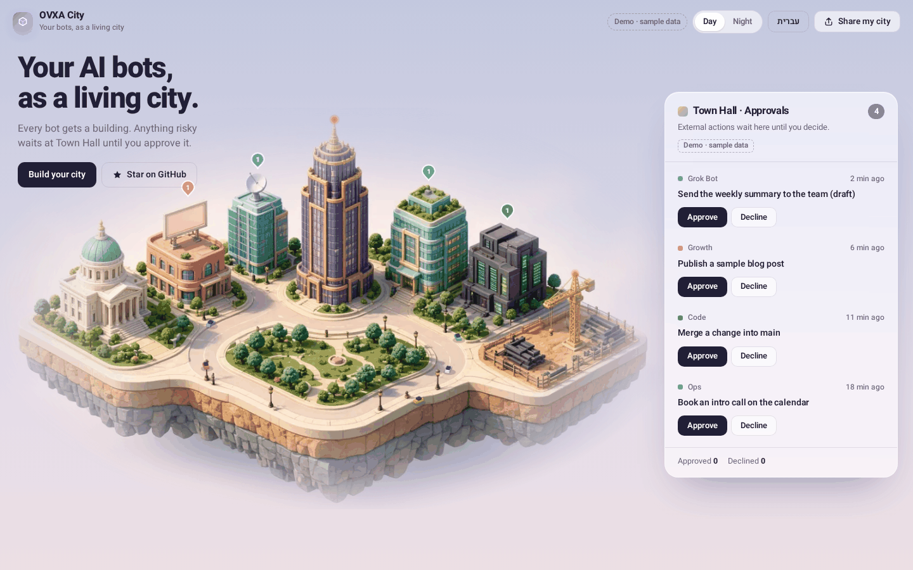
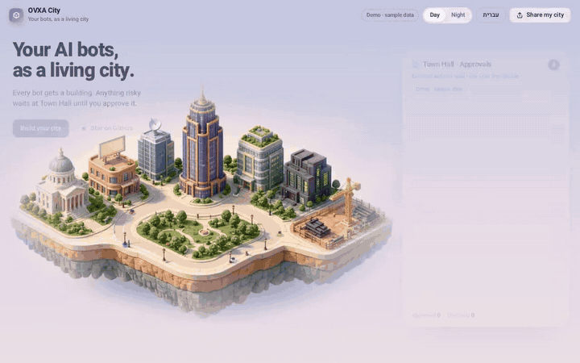
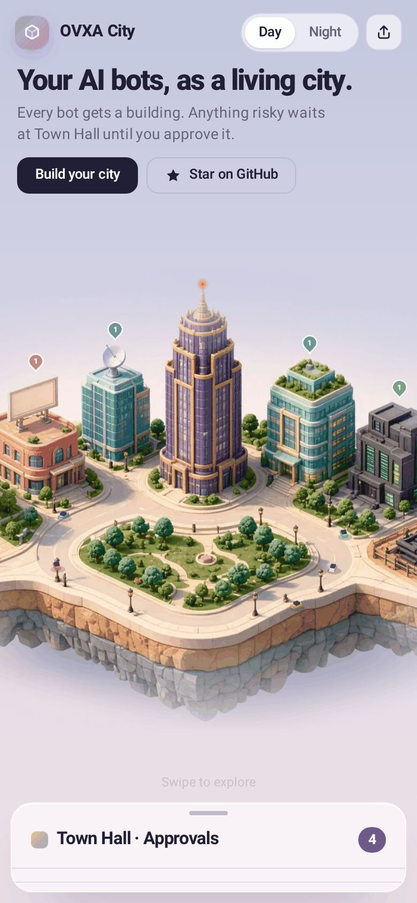
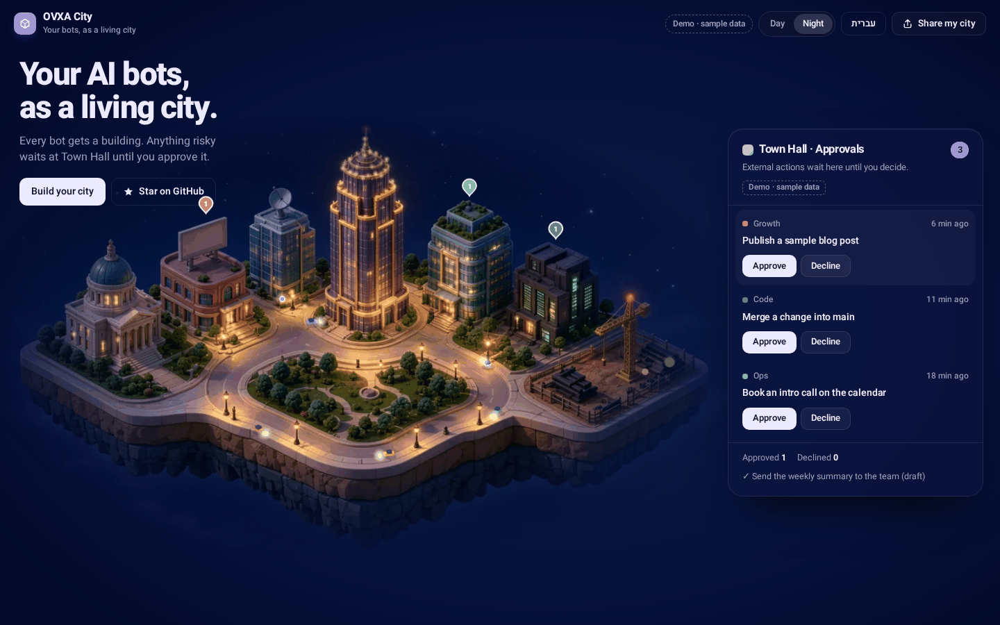

<div align="center">



# OVXA City

**Your AI bots, as a living city.** Every bot gets a building. Anything risky waits at Town Hall until you approve it.

[Live demo (sample data)](#demo) · [5-minute setup](#5-minute-setup) · [Routine prompts](docs/ROUTINES.md) · ⭐ [Star OVXA](https://github.com/ovxa-ai)

[](https://deploy.workers.cloudflare.com/?url=https://github.com/ovxa-ai/ovxa-city)

</div>

---



## What it is

- **A city of your bots.** Buildings are config-driven. Your chief of staff takes the tower, your router takes the dish, and the rest move into the offices. A new bot shows up as a crane on the construction lot.
- **Town Hall.** A single queue of actions your bots are holding for you. Approve or decline, and the decision goes straight to that bot's webhook.
- **Day and night.** Real window lights, cars with headlights, reduced-motion support, keyboard navigation and a mobile bottom sheet.
- **English and Hebrew (RTL)** out of the box. Add a language in `src/i18n.ts`.
- **Share my city.** One click exports a PNG of your skyline with your bot names. It never includes request contents.

## Honest limits

- **There's no public Grok Bot API.** OVXA City doesn't read your bots. Your bots push their status to it through a **scheduled routine**.
- **Approvals only cover what your routine reports.** Grok Bot's built-in in-app approval cards can't be answered from here.
- A decision reaches a bot only if that bot has a routine webhook configured.
- Without a backend, the page runs in **demo mode** with clearly labeled sample data.

## 5-minute setup

You need Node 20+, a Cloudflare account and `npx wrangler login`.

```bash
git clone https://github.com/ovxa-ai/ovxa-city && cd ovxa-city
npm install

# 1. storage
npx wrangler kv namespace create CITY_KV     # paste the id into wrangler.toml

# 2. secrets (never committed)
npx wrangler secret put OWNER_PASSWORD
npx wrangler secret put SESSION_SECRET        # openssl rand -hex 32
npx wrangler secret put BOTS                  # see below

# 3. ship
npm run deploy
```

`BOTS` is a JSON object with one entry per bot:

```json
{
  "chief":  { "name": "Chief of Staff", "role": "chief",  "token": "<random>", "webhook": "https://…", "webhookKey": "<from routine>" },
  "grok":   { "name": "Grok Bot",       "role": "router", "token": "<random>", "webhook": "https://…", "webhookKey": "<from routine>" },
  "growth": { "name": "Growth",         "role": "worker", "token": "<random>" }
}
```

Next, give each bot the two routines in **[docs/ROUTINES.md](docs/ROUTINES.md)**: a status push and a decision webhook. Open your city and sign in with `OWNER_PASSWORD`.

**Prefer Cloudflare Access?** Protect the route with Access and set `ACCESS_EMAIL` in `wrangler.toml`. The Worker then trusts `cf-access-authenticated-user-email` for that address only.

## API

| Route | Who | What |
|---|---|---|
| `POST /api/status` | bot (`Bearer <token>`) | `{status, message, pending:[{id,title,detail,kind,created_at}]}` |
| `GET /api/state` | anyone / owner | bots and statuses. `pending` and the log are returned to the owner only |
| `POST /api/decision` | owner | `{bot_id, request_id, decision}` is forwarded to the bot's webhook as `{request_id, decision}` |
| `POST /api/login` · `/api/logout` · `GET /api/me` | owner | password session (HMAC-signed, HttpOnly, SameSite=Strict) |

An item is removed only after the bot's webhook accepts the decision. Decided IDs are remembered, so a late status push can't bring them back. Inputs are size-capped and validated, and login and decision requests are origin-checked.

## Develop

```bash
npm run dev          # frontend with demo data, http://localhost:5173/?demo
cp .dev.vars.example .dev.vars && npm run build && npm run worker:dev   # full stack
npm test             # Worker tests (vitest)
```

Deploying only the frontend to Cloudflare Pages? Build with `VITE_API_BASE=https://your-worker.example`.

<table><tr><td></td><td></td></tr></table>

<a name="demo"></a>
## Built with OVXA

OVXA is **the UI Intelligence Engine for Generative UI**. If this made you smile, **[⭐ star ovxa-ai](https://github.com/ovxa-ai)** so more people find it.

MIT © OVXA
